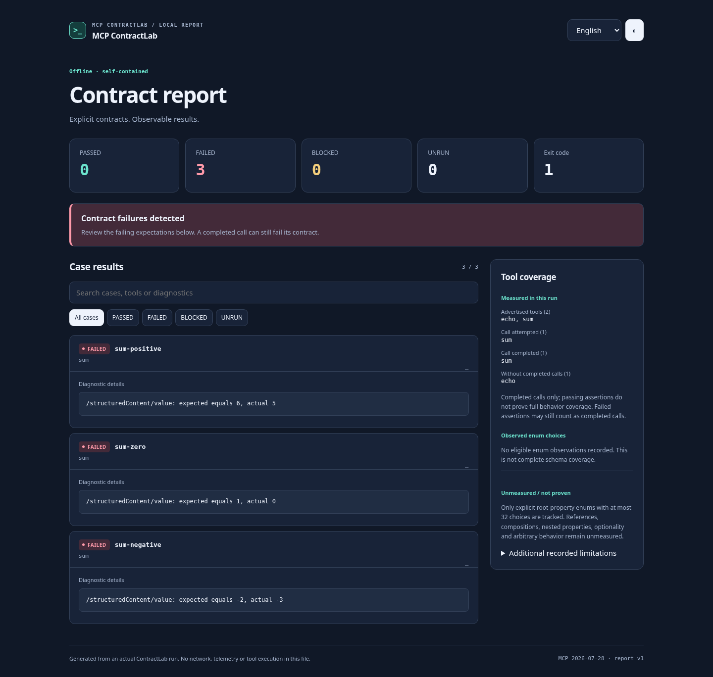
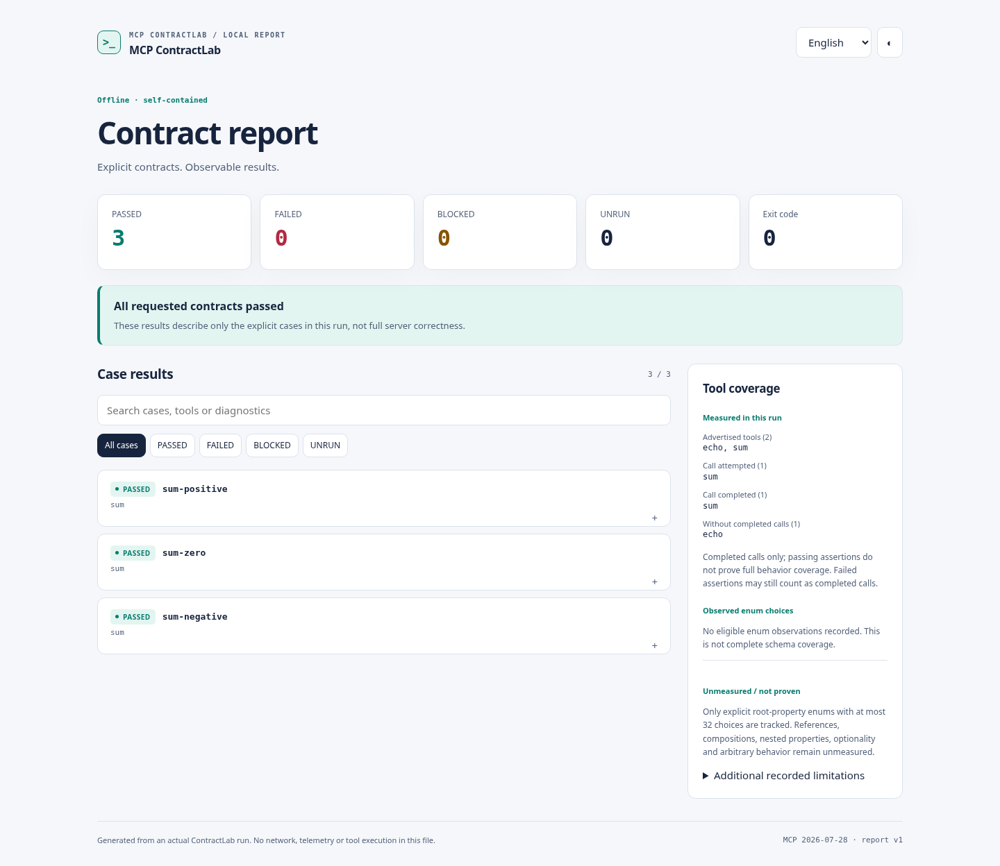
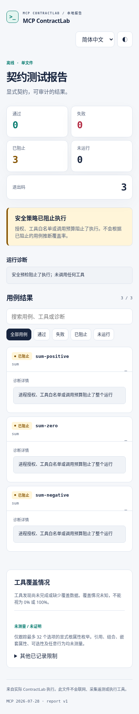

[English](README.md) · [简体中文](README.zh-CN.md)

<picture>
  <source media="(prefers-color-scheme: dark)" srcset="assets/brand/logo-dark.svg">
  
</picture>

# MCP ContractLab

**Test your MCP tools before your agents trust them.**

Checked-in examples of expected tool behavior, repeatable assertions and conservative
interface gates. Run only explicitly authorized cases; keep a readable, offline
report of what passed, failed or never ran. Independent, MIT-licensed and CPU-only.

[](https://github.com/dajinzhu/mcp-contractlab/actions/workflows/ci.yml)

**Unpublished beta.** The npm package is private and has not been publicly
published. Install from source below; do not use `npx mcp-contractlab` or npm global
installation. Not production-ready. Targets **MCP 2026-07-28** with the official
split TypeScript SDK **2.4.0**. Node.js **>=22.13.0**, tested on Node **22 and 24**;
older protocol revisions are not verified. No LLM key, GPU, database or account.

## Quick start from source

```sh
git clone https://github.com/dajinzhu/mcp-contractlab.git
cd mcp-contractlab
npm ci
npm run build
npm run cli -- test -c examples/mcpcl.config.yaml --allow-exec --lang en
```

Three side-effect-free local `sum` cases pass; exit **0**. Relative server paths
resolve from the config's directory. `--allow-exec` grants process launch consent,
not a sandbox or automatic tool permission.

Save a bilingual, self-contained report to a **new** filename:

```sh
npm run cli -- test -c examples/mcpcl.config.yaml --allow-exec --report html --output report.html --lang en
```

Double-click `report.html` or use your browser's **Open File** command. English /
简体中文, light/dark themes, search and filters work offline. No CDN, remote fonts, telemetry
or backend. HTML requires a new output file, never overwrites existing files or
links, and has a complete **4 MiB** budget. Choose another filename for another run.
See [reports and limits](docs/reports.md) and [language selection](docs/i18n.md).

## See the actual product

This is the **deliberately failing local fixture**: three failures, exit **1**,
with expected/actual values and JSON Pointers. It is a real generated report, not a
mockup, customer result or production accuracy measurement.



| Fixture                         | Observed result                     | Report                                     |
| ------------------------------- | ----------------------------------- | ------------------------------------------ |
| Passing local `sum` cases       | 3 passed; exit 0                    | [HTML](docs/examples/html/passed.html)     |
| Deliberately wrong expectations | 3 failed; exit 1                    | [HTML](docs/examples/html/failed.html)     |
| No launch consent               | 3 blocked; exit 3; coverage unknown | [HTML](docs/examples/html/blocked.html)    |
| Local server crash              | 1 failed, 1 unrun; exit 2           | [HTML](docs/examples/html/incomplete.html) |

GitHub displays HTML source: download a report, then open it locally.
[Provenance and reproduction](docs/examples/html/README.md).

<details>
<summary>More real screenshots: passing desktop and blocked Chinese mobile</summary>





</details>

To reproduce failure or a safety block:

```sh
npm run cli -- test -c examples/mcpcl.broken.yaml --allow-exec --lang en
npm run cli -- test -c examples/mcpcl.config.yaml --lang en
```

These deliberately exit **1** and **3**. The broken YAML changes expectations;
it does not secretly mutate the server. The next example changes the server itself.

## Before / after: catch a removed tool

| Before                                   | After                                                     | Compatibility gate             |
| ---------------------------------------- | --------------------------------------------------------- | ------------------------------ |
| Local server advertises `echo` and `sum` | A second local implementation removes `sum`, keeps `echo` | `sum` → `BREAKING`; exit **1** |

```sh
npm run cli -- snapshot -c examples/mcpcl.config.yaml --allow-exec --output before.snapshot.json
npm run cli -- diff -c examples/mcpcl.removed-tool.yaml --allow-exec --baseline before.snapshot.json --report console --lang en
```

The diff discovers both interfaces and **calls no tools**. Baselines are not
updated by `test` or `diff`. Use a new baseline path above. [Actual diff JSON and
reproduction](docs/demos/README.md) document the deliberate local implementation
change; no artificial “previously present” tool is inserted into the baseline.
Complex schemas remain `UNKNOWN`; `--strict` also gates on `UNKNOWN`. A simple
schema diff cannot prove arbitrary JSON Schema compatibility.

## What works today

- Explicit cases and tool allowlists, sequential calls, no automatic retries.
- JSON Pointer `equals`, `exists`, `type`; missing is distinct from `null`.
- Input and advertised structured-output validation with JSON Schema 2020-12 in
  bounded workers; external references are never fetched.
- Parameterized rows, canonical snapshots and conservative interface diffs.
- English/Chinese console and offline HTML; stable JSON and JUnit for CI.
- Distinct discovered, attempted, completed and untested **tools**; eligible root
  enum observations. This is not full schema or semantic coverage.
- Stdio and reviewed Streamable HTTP endpoints, with explicit launch/network
  consent, exact HTTPS host/endpoint authorization, public DNS pinning and bounds.
  HTTP examples use a placeholder host; OAuth is not implemented.

```sh
npm run cli -- inspect -c examples/mcpcl.config.yaml --allow-exec
npm run cli -- test -c examples/mcpcl.parameterized.yaml --allow-exec --report json
npm run cli -- test -c examples/mcpcl.config.yaml --allow-exec --report junit --output report.xml
```

`inspect` and `diff` default to JSON; `--report console` gives a localized human
view. HTML is currently for `test` only. Locale never changes machine fields,
snapshots, authorization or exit semantics.

## Safety and exit codes

| Exit  | Meaning                                                                                  |
| ----- | ---------------------------------------------------------------------------------------- |
| **0** | Requested checks passed                                                                  |
| **1** | Contract failure or declared compatibility gate failure                                  |
| **2** | Invalid config, empty suite, operational/transport failure, interruption or report error |
| **3** | Safety policy blocked execution                                                          |

Launching stdio requires `--allow-exec`; calls additionally require explicit cases
and `safety.allowToolCalls`. A denied case or exhausted preflight budget blocks the
whole suite before launch. `inspect`, `snapshot` and `diff` never call tools.
Transport failures stop subsequent calls; unrun cases are not passes.

**Consent does not sandbox programs or their side effects.** Review executable
paths and endpoint permissions; use disposable environments and read-only
credentials. Do not point tests at production tools without reviewing their effects.
Reports redact known secrets, but baselines retain advertised schemas/defaults:
review them before committing. See [security boundaries](docs/security.md).

## How this fits with other MCP tools

| Tool                                                                              | Useful focus                                                                                     |
| --------------------------------------------------------------------------------- | ------------------------------------------------------------------------------------------------ |
| MCP ContractLab                                                                   | Repeatable, explicitly authorized application behavior examples and conservative interface gates |
| [MCP Inspector](https://github.com/modelcontextprotocol/inspector)                | Connecting to, exploring and debugging MCP servers, including CLI workflows                      |
| [Official conformance suite](https://github.com/modelcontextprotocol/conformance) | Protocol scenarios and specification requirements                                                |

These are complementary emphases, not proof of exclusive features or superiority.
ContractLab does not certify protocol conformance or replace an inspector.
[Documented overlap and dated observations](docs/competitive-notes.md) also cover
mcpward and MCPLint. No external user adoption or real-world accuracy is claimed.

## Development and contribution

Build first: integration tests use compiled local fixtures.

```sh
npm ci
npm run build
npm run typecheck
npm run lint
npm run format:check
npm test
npm run test:unit
npm run test:smoke
npm run test:package
npm run docs:check
npx playwright install chromium
npm run test:browser
```

CI runs Node 22, Node 24 and Chromium. Independent upstream fixture checks require
Node 24; they are additional checks, not skipped tests in the main suite. See
[contributing](CONTRIBUTING.md) for first-PR guidance, browser setup, negative exit
checks, independent fixture instructions and evidence requirements.

## FAQ

**Can I install this from npm?** Not yet. Use this source checkout or a reviewed
local tarball. `private: true` remains enabled; publication needs separate approval.

**Does a green report prove my server is safe or fully covered?** No. It describes
only explicit cases and measured branches. Unmeasured coverage stays unmeasured;
synthetic fixture results are not production accuracy claims.

**Why did a report or comparison fail?** Check the exit code and diagnostic.
A failed assertion is not a transport failure; a blocked run is not a pass.
HTML destinations must be new files. [Report details](docs/reports.md).

**Which protocols and credentials are supported?** The product targets only
2026-07-28. Stdio environment injection and optional HTTP Bearer auth use explicit
variable names; OAuth and legacy-protocol fallback are not implemented.

## Documentation and next steps

[Configuration](docs/configuration.md) · [Reports](docs/reports.md) ·
[Compatibility](docs/compatibility.md) · [Architecture](docs/architecture.md) ·
[Language policy](docs/i18n.md) · [Research limits](docs/research.md) ·
[Project overview and GitHub metadata suggestions](docs/project-overview.md) ·
[Roadmap](docs/roadmap.md) · [Release gates](docs/releasing.md) ·
[Engineering rules](AGENTS.md) · [Original plan](CODEX_BUILD_PLAN.md) · [MIT license](LICENSE)

Next priorities are external reproduction and feedback, owner-controlled live HTTPS
interoperability, and careful release preparation. No published beta, public-host
TLS verification, external feedback or production readiness is implied by this PR.

Release preparation and future npm installation drafts are separate from today’s
unpublished source instructions: [release-readiness assessment](docs/releases/README.md).
