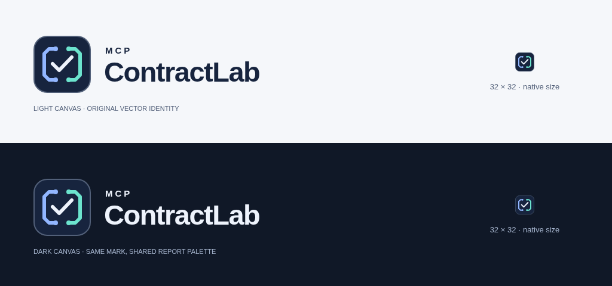

# MCP ContractLab identity

An original geometric **contract brackets + verification check** mark, drawn for
this repository. The two facing brackets suggest separate tool contracts; paired
terminals and a central check suggest connection and verification. This is not a
modification of the MCP, GitHub or another product's logo. It is not a trademark
clearance or a claim of unique ownership of the word “ContractLab”.

All artwork here is distributed under the repository's [MIT license](../../LICENSE).
No third-party artwork, font files or stock icons are embedded. The SVG wordmarks
use a local Arial/Helvetica/sans-serif stack; appearance can vary slightly by
platform. PNG exports freeze the rendered wordmark for contexts needing fixed type.

| Asset                                                                        | Use                                                |
| ---------------------------------------------------------------------------- | -------------------------------------------------- |
| `logo-icon.svg`                                                              | Universal navy-backed symbol, light or dark canvas |
| `logo-horizontal.svg`                                                        | Horizontal wordmark for light backgrounds          |
| `logo-dark.svg`                                                              | Horizontal wordmark for dark backgrounds           |
| `logo-icon-32.png`, `logo-icon-64.png`, `logo-icon-256.png`, `logo-icon.png` | 32, 64, 256 and 512 px icons                       |
| `logo-horizontal.png`, `logo-dark.png`                                       | Transparent 840 × 224 wordmarks                    |

Palette is shared with the offline HTML report: navy `#17243e`, blue `#326dde`,
light blue `#92b6ff`, mint `#6ce4ce`, light ink `#eef3fc`. The navy tile retains
contrast on either canvas. Use the 32 px export at native size to check small use;
keep clear space around the mark and do not stretch or recolor individual parts.
System sans-serif typography keeps documentation and the report consistent without
remote fonts. No HTML renderer, CSP or core test-engine change is needed.

Regenerate PNGs after installing the existing Playwright development dependency:

```sh
npx playwright install chromium
npm run brand:export
```

For the managed cloud Chromium, `CHROMIUM_PATH=/usr/bin/chromium npm run brand:export`
uses the available binary. Export runs with JavaScript disabled and networking
offline. SVGs contain only local vector shapes and text: no scripts, references,
embedded raster images, filters, animation or external styles.

## Rendered light/dark review

The icon below is shown at its **native 32 px size**, not enlarged. This sheet is
an actual browser rendering of the SVG wordmarks and exported PNG icons; it is not
a product screenshot or a metric. Regenerate with `npm run test:brand-browser`;
set `MCPCL_BRAND_PREVIEW=assets/brand/preview.png` to update this checked-in sheet.


